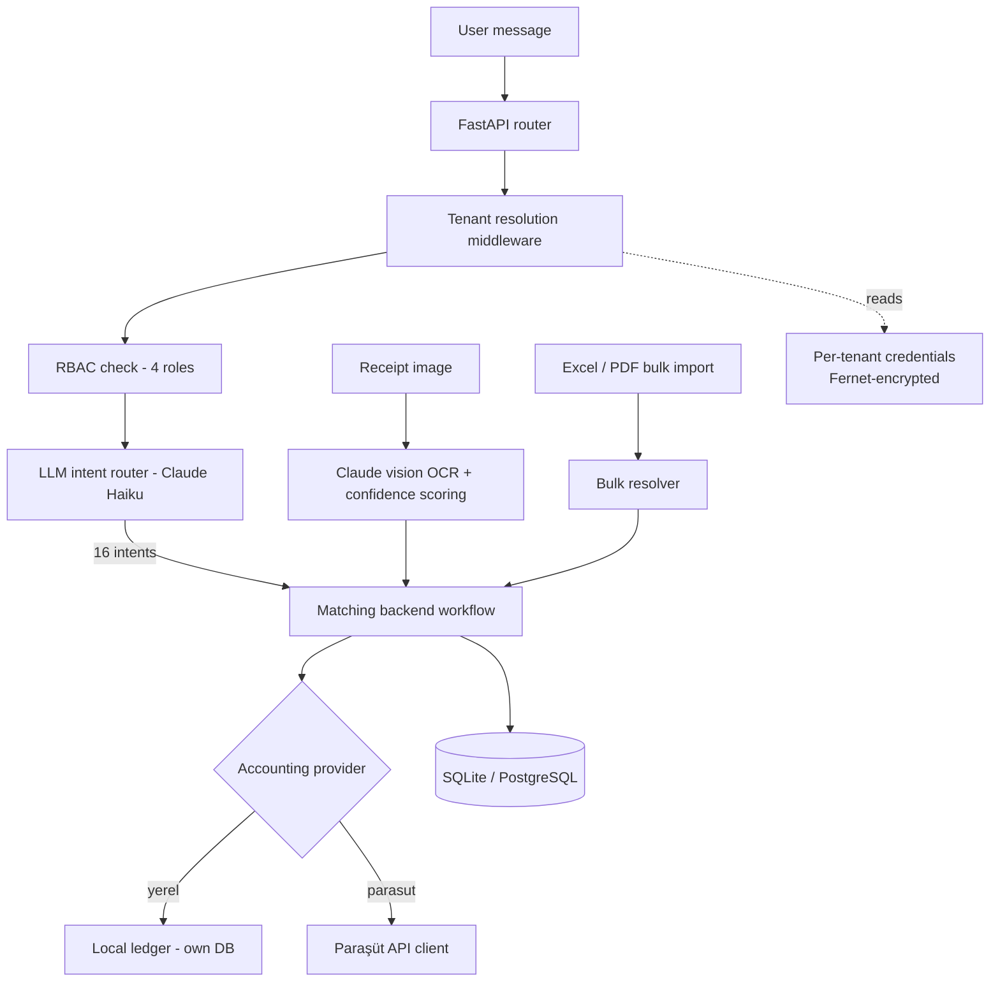

# Profaix (HamzAI) — Multi-Tenant Accounting Automation Agent

A multi-tenant backend that puts a conversational layer over accounting, so a scrap-metal
accounting team can issue invoices, record collections, create waybills and pull reports by
typing a sentence instead of navigating an ERP UI.

The accounting backend is **pluggable**: records go either to Profaix's own database
(`MUHASEBE_SAGLAYICI=yerel`, default — no external account needed, exportable to Excel) or to
the **Paraşüt ERP API** (`MUHASEBE_SAGLAYICI=parasut`).

---

## Hızlı başlangıç (lokal, Paraşüt gerekmez)

**Windows:** klasörde `baslat.bat` dosyasına çift tıkla.
**macOS / Linux:** `./baslat.sh`

İlk çalıştırmada sanal ortamı kurar, paketleri yükler, `.env` dosyasını rastgele güvenlik
anahtarlarıyla oluşturur ve tarayıcıda `http://localhost:8000/login` açılır.

- Giriş: **admin / profaix123** (`.env` içinde `ADMIN_PASSWORD` ile değiştirilebilir)
- Veritabanı: proje klasöründe `profaix_yerel.db` (SQLite — kurulum gerekmez)
- İlk açılışta örnek (uydurma) cariler, faturalar, irsaliyeler ve tahsilatlar yüklenir
- Video çekmeden önce temiz başlangıç: `baslat.bat --sifirla` / `./baslat.sh --sifirla`
- Örnek kantar fişi görseli: `demo/ornek_kantar_fisi.jpg`

**Claude API anahtarı (opsiyonel):** `.env` içine `ANTHROPIC_API_KEY` yazılırsa sohbet Claude
ile anlar ve kantar fişi fotoğrafı otomatik okunur. Yazılmazsa uygulama yine çalışır: sohbet
basit anahtar-kelime moduna geçer, fiş bilgileri forma elle girilir.

**Paraşüt'e bağlamak:** `.env` içinde `MUHASEBE_SAGLAYICI=parasut` yap ve `PARASUT_*` alanlarını doldur.

**Testler:** `pip install -r requirements-dev.txt` → `python -m pytest -q`

Built end to end as a solo developer: architecture, backend, LLM layer, front-end and deployment.
~10,000 lines of Python.

> **Status:** feature-complete and deployed to a hosted environment. It did not go into
> production use — the commercial agreement with the client was not concluded.

---

## What it does

A user writes something like *"Ahmet Yılmaz'a 12 ton hurda için fatura kes"* and the system:

1. Classifies the sentence into one of **16 accounting intents**
2. Resolves the counterparty against the ERP (creating it if missing)
3. Builds the correct Paraşüt payload for that intent
4. Executes the call under that tenant's own ERP credentials
5. Returns a human-readable confirmation and records the transaction for billing

It also ingests receipts by photo (OCR), imports bulk Excel/PDF documents, and meters usage
per transaction.

---

## Architecture



### Design decisions worth explaining

**Intent routing on a small model.** Requests are classified by Claude Haiku rather than
being answered by a large model. The LLM decides *which* deterministic workflow runs; it never
constructs the ERP payload itself. This keeps accounting operations auditable and reproducible,
and keeps cost per request low.

**Multi-tenancy without credential sprawl.** Each tenant stores its own Paraşüt client ID,
secret, username, password and company ID. These are encrypted at rest with **Fernet** and
resolved by middleware on every request, so no tenant can ever reach another tenant's ERP.
A 5-minute TTL cache in front of tenant lookup removes a database round-trip per message.

**RBAC enforced in middleware, not in the UI.** Four roles are checked at the request-path
level before a handler runs. The front-end menu mirrors the same rules, but the menu is a
convenience — the middleware is the boundary.

**Counterparty resolution.** Bulk imports rarely match the ERP exactly. The importer resolves
names against existing counterparties and creates them when there is no match, so a 200-row
Excel file does not become 200 manual lookups.

---

## Tech stack

| Layer | Choice |
|---|---|
| API | FastAPI, Pydantic |
| LLM | Anthropic Claude (Haiku for routing, Sonnet for receipt OCR) |
| Database | SQLite (local) or PostgreSQL, SQLAlchemy, automated migrations |
| Auth | JWT, bcrypt, role-based access control |
| OCR | Claude vision + Pillow preprocessing + hybrid confidence scoring |
| Crypto | Fernet (per-tenant credential encryption) |
| Ops | Docker, structured logging, keep-alive health check |

---

## Layout

```
main.py                 FastAPI app: middleware + router registration
app/
  auth.py               JWT, bcrypt, first-admin bootstrap
  core/
    config.py           environment validation
    database.py         SQLAlchemy models (tenants, invoices, transactions…)
    migrations.py       schema migrations
    logger.py           structured logging
  chatbox/
    llm_handler.py      intent classification (+ keyword fallback without API key)
  muhasebe/             accounting provider layer — routers import only from here
    __init__.py         picks the provider from MUHASEBE_SAGLAYICI
    irsaliye_akisi.py   receipt → waybill flow (provider-agnostic)
    yerel/              local ledger provider (models, service, Excel export, demo data)
  parasut/              Paraşüt ERP API client (the "parasut" provider)
  ocr/                  receipt ingestion (Claude vision + confidence scoring)
  toplu/                bulk Excel / PDF import
  routers/              endpoint modules, shared deps.py
static/                 front-end (vanilla JS, CSS)
```

---

## Running locally (manual)

```bash
python -m venv .venv && source .venv/bin/activate   # Windows: .venv\Scripts\activate
pip install -r requirements.txt
cp .env.example .env        # set JWT_SECRET_KEY, ADMIN_TOKEN, ADMIN_PASSWORD
uvicorn main:app --reload --port 8000
```

The app validates required configuration on startup and refuses to boot with missing keys.
With `MUHASEBE_SAGLAYICI=yerel` (default) no Paraşüt credentials are needed; with
`MUHASEBE_SAGLAYICI=parasut` the tenant's live Paraşüt credentials are required.

---

## What I would change next

- Replace the intent classifier with a small fine-tuned model to cut latency and remove the
  API dependency on the hot path.
- Move bulk import to a background worker; today a large file blocks the request.
- Add contract tests against a recorded Paraşüt fixture set so ERP changes surface in CI
  (the local provider already has a pytest suite under `tests/`).
