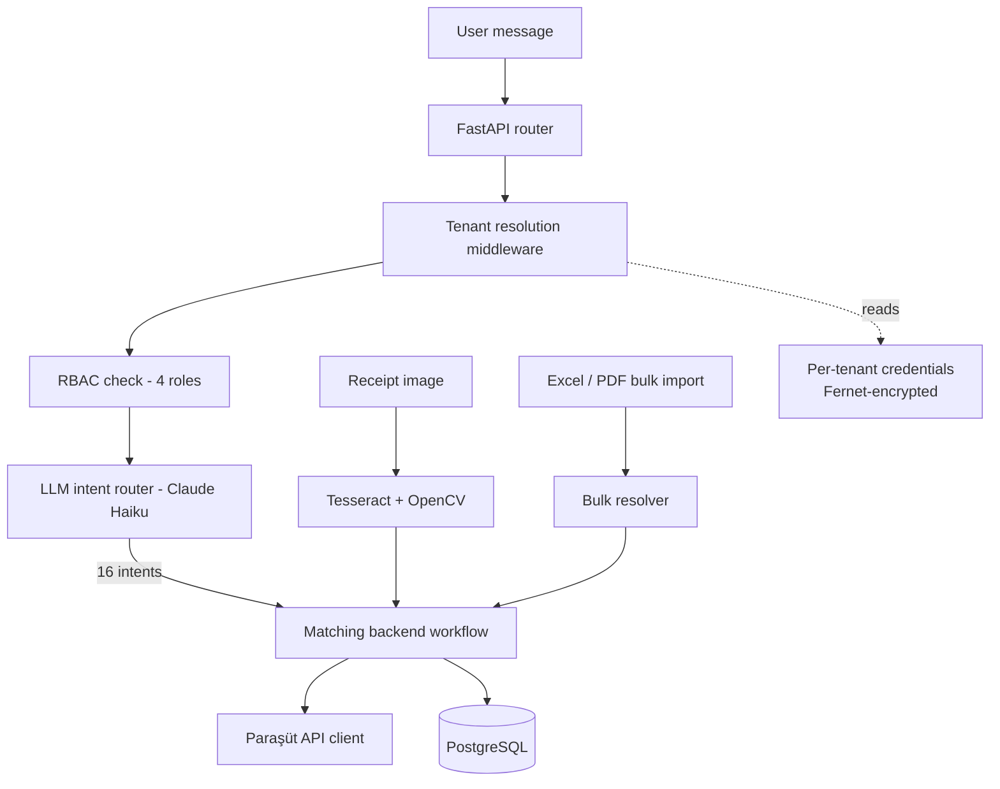

# Profaix (HamzAI) — Multi-Tenant Accounting Automation Agent

A multi-tenant backend that puts a conversational layer over the **Paraşüt ERP API**, so an
accounting team can issue invoices, record collections, create waybills and pull reports by
typing a sentence instead of navigating an ERP UI.

Built end to end as a solo developer: architecture, backend, LLM layer, front-end and deployment.
~10,000 lines of Python.

> **Status:** feature-complete and deployed to a hosted environment. It did not go into
> production use — the commercial agreement with the client was not concluded.

---

## What it does

A user writes something like *"Ahmet Yılmaz'a 12 ton hurda için fatura kes"* and the system:

1. Classifies the sentence into one of **16 accounting intents**
2. Resolves the counterparty against the ERP (creating it if missing)
3. Builds the correct Paraşüt payload for that intent
4. Executes the call under that tenant's own ERP credentials
5. Returns a human-readable confirmation and records the transaction for billing

It also ingests receipts by photo (OCR), imports bulk Excel/PDF documents, and meters usage
per transaction.

---

## Architecture



### Design decisions worth explaining

**Intent routing on a small model.** Requests are classified by Claude Haiku rather than
being answered by a large model. The LLM decides *which* deterministic workflow runs; it never
constructs the ERP payload itself. This keeps accounting operations auditable and reproducible,
and keeps cost per request low.

**Multi-tenancy without credential sprawl.** Each tenant stores its own Paraşüt client ID,
secret, username, password and company ID. These are encrypted at rest with **Fernet** and
resolved by middleware on every request, so no tenant can ever reach another tenant's ERP.
A 5-minute TTL cache in front of tenant lookup removes a database round-trip per message.

**RBAC enforced in middleware, not in the UI.** Four roles are checked at the request-path
level before a handler runs. The front-end menu mirrors the same rules, but the menu is a
convenience — the middleware is the boundary.

**Counterparty resolution.** Bulk imports rarely match the ERP exactly. The importer resolves
names against existing counterparties and creates them when there is no match, so a 200-row
Excel file does not become 200 manual lookups.

---

## Tech stack

| Layer | Choice |
|---|---|
| API | FastAPI, Pydantic |
| LLM | Anthropic Claude (Haiku for routing) |
| Database | PostgreSQL, SQLAlchemy, automated migrations |
| Auth | JWT, bcrypt, role-based access control |
| OCR | Tesseract + OpenCV |
| Crypto | Fernet (per-tenant credential encryption) |
| Ops | Docker, structured logging, keep-alive health check |

---

## Layout

```
main.py                 FastAPI app: middleware + router registration
app/
  auth.py               JWT, bcrypt, first-admin bootstrap
  core/
    config.py           environment validation
    database.py         SQLAlchemy models (tenants, invoices, transactions…)
    migrations.py       schema migrations
    logger.py           structured logging
  chatbox/
    llm_handler.py      intent classification + response generation
  parasut/              Paraşüt ERP API client
  ocr/                  receipt ingestion (Tesseract + OpenCV)
  toplu/                bulk Excel / PDF import
  routers/              endpoint modules, shared deps.py
static/                 front-end (vanilla JS, CSS)
```

---

## Running locally

```bash
pip install -r requirements.txt
cp .env.example .env        # fill in database URL, Anthropic key, Fernet key
python main.py
```

The app validates required configuration on startup and refuses to boot with missing keys.

> **Note:** the Paraşüt integration requires live ERP credentials, which are tenant-owned and
> not included in this repository. Without them the conversational layer runs but ERP calls
> will fail — this is intentional.

---

## What I would change next

- Replace the intent classifier with a small fine-tuned model to cut latency and remove the
  API dependency on the hot path.
- Move bulk import to a background worker; today a large file blocks the request.
- Add contract tests against a recorded Paraşüt fixture set so ERP changes surface in CI.
